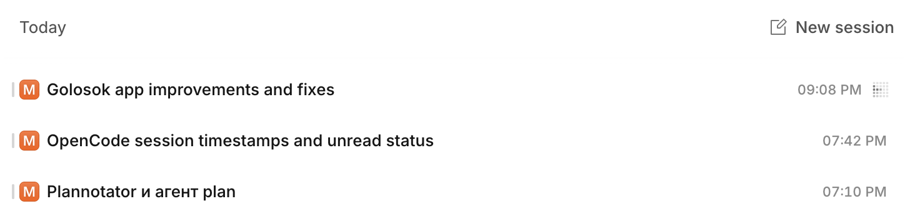
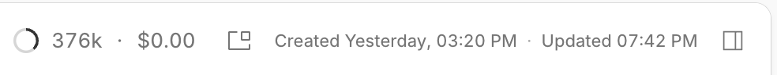
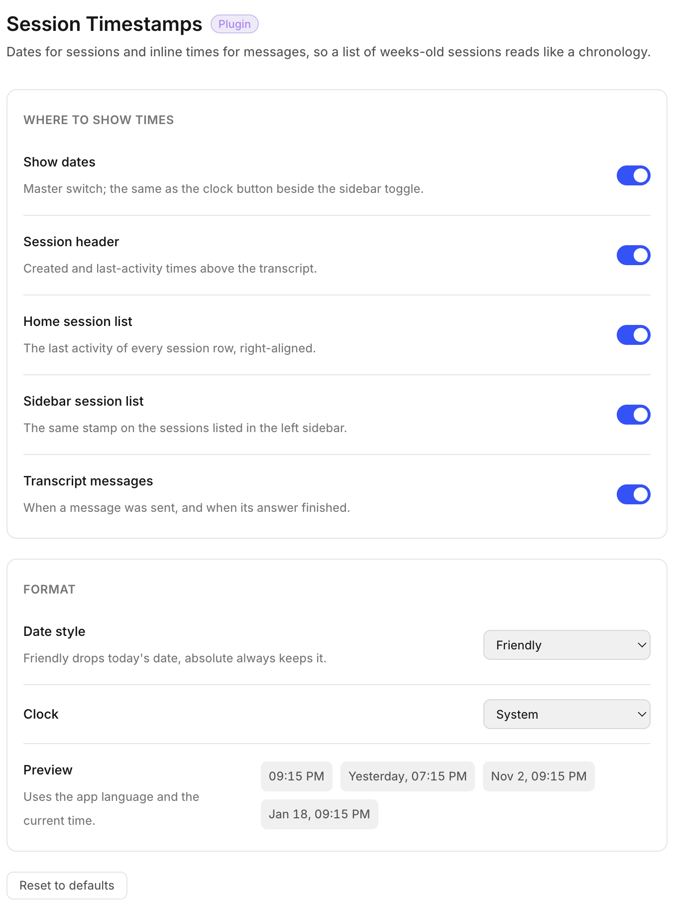
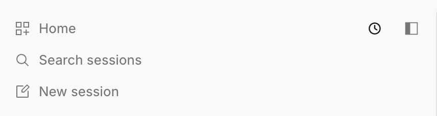
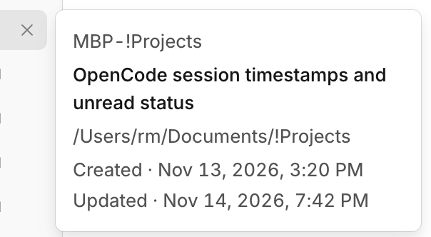

# opencode-session-timestamps

> **Dates and times where OpenCode Desktop does not show them: session headers, Home and sidebar rows, session tabs, and every transcript turn.**  
> 🌐 *[Документация на русском языке (Russian documentation)](./README_RU.md)*

[](https://opencode.ai/)
[](https://www.typescriptlang.org/)
[](https://www.solidjs.com/)
[](LICENSE)

---

## Why

OpenCode Desktop groups Home sessions into **Today / Yesterday / Older** and never renders a session row's date. The transcript shows a turn's duration, but not when it happened. That makes a session from last week and one from six months ago look the same until you open them.

This plugin adds those chronology anchors without touching the server: it reads `session.time.created/updated` and `message.time.created/completed` from the app's own synced data.

---

## ✨ Features

- **Session header** — `Created 12 Nov, 03:20 · Updated 13 Nov, 15:42` next to the session title, with the full timestamp in the tooltip; compact mode keeps only the last activity.
- **Home session list** — a right-aligned last-activity stamp on every row.
- **Sidebar session list** — how long ago each session was active (`49m`, `3h`, `2d`), like the Inbox layout, or the date when **Relative time in sidebar** is switched off. Sidebar rows carry no session id in the DOM, so they are matched by their unique title; duplicate titles are skipped.
- **Session tabs** — a compact clock that reserves the app's 24px status area, so unread/attention dots and the close button never overlap it. Hidden on hover and in tabs narrower than 150px.
- **Tab hover preview** — separate **Created** and **Updated** lines with localized full dates.
- **Context usage rings** — every Home row, sidebar row, Inbox row and tab shows the share of the model's context window its last answer used, drawn with the same 14px ring as the session header. Neutral below 80%, amber from 80%, red from 95%; the tooltip names the percentage, used tokens and limit. In the Inbox layout the ring sits right of the row's own elapsed time.
- **Transcript turns** — `15:42 → 15:43` above each user message: when it was sent and when its answer finished. Running turns show the send time only.
- **Quick switches** — a clock button beside the sidebar toggle hides or shows every date, and a ring button next to it does the same for context rings, both without opening Settings (dimmed when off).
- **Settings → Session Timestamps** — a master switch and a toggle per surface for dates, a separate **Context usage** section for rings, friendly (`15:42`, `Yesterday, 09:05`, `12 Nov, 15:42`), always-absolute or relative sidebar dates, a 12/24-hour clock, and a live preview in the current language.
- **Localized** — English and Russian catalogs; the app language is followed live, with an English fallback.
- **Light and dark** — every injected surface reads the app's theme variables, with `light-dark()` fallbacks, so the plugin follows the app theme without its own palette.

All times follow the app language and update live when a session changes.

---

## 📸 Screenshots

### Home session list



Every row ends with the session's last activity, so a session from today, yesterday or last month no longer looks the same.

### Session header



A session's **Created** and **Updated** times sit beside its token and cost readout; the full date with seconds is in the tooltip.

### Settings



**Settings → Session Timestamps**: a master switch, one toggle per surface, friendly or always-absolute dates, relative sidebar time, a 12/24-hour clock, and a live preview in the app language.

### Quick switch



The clock button beside the panel toggle hides or shows every date in one click (dimmed when off).

### Tab hover preview



The tab hover preview gains separate **Created** and **Updated** lines with full, localized dates.

---

## 📦 Installation

### Option A: install from GitHub

```bash
opencode plugin add github:Realmagnum/opencode-session-timestamps
```

### Option B: add to the config

```json
{
  "plugins": ["/absolute/path/to/opencode-session-timestamps"]
}
```

Then reload the window with `Cmd+R` — the GUI half is loaded per window. Requires OpenCode Desktop 2.2+.

---

## ⚙️ How it works

The session header uses the official `session.header` slot. Home/sidebar rows, tabs, the hover preview and transcript turns have no slot, so the plugin appends `<time>` nodes to the app's DOM and reconciles them with a `MutationObserver`; each pass re-adds what the app re-rendered away.

- Times for loaded sessions come from `ctx.servers[*].data.session` / `data.session.message` (reactive stores).
- Rows the store never loaded fall back to a bounded `session.list` index (500 newest per server), refreshed on execution, rename, archive and delete events.
- Sidebar rows are matched by unique title; tabs and their hover preview by the `href`'s `ses_...` id.
- Inbox rows print their own relative age and carry no session id, so only the context ring is appended, into the trailing group of the second line — right of that time. The title printed in the row is matched under the same unique-title rule.
- Sidebar stamps read `49m` / `3h` / `2d` (`now` under a minute) unless **Relative time in sidebar** is off; the tooltip keeps the exact created and updated times either way.
- The timeline turn clock maps the user message id to the last assistant `time.completed` of that turn.

---

## 🛠 Build

```bash
npm install
npm run build        # vite build + copy gui-experimental.cjs to the package root
npm run typecheck
npm test             # i18n key parity, fallback and elapsed formatting
npm run ci           # typecheck + test + build
```

---

## Known limits

- Sidebar rows with duplicate titles are not stamped. Home rows, headers, tabs and the transcript are unaffected.
- Inbox rows with duplicate titles (and untitled ones, which all read "Session") get no ring, for the same reason.
- A transcript turn whose user message is outside the virtualized window has no stamp until it scrolls into view.
- Only the active timeline gets turn stamps; a cached, hidden timeline keeps the stamps it had.
- The tab clock is hidden while hovering a tab, where the app shows its close button in the same 24px.

---

## License

MIT
