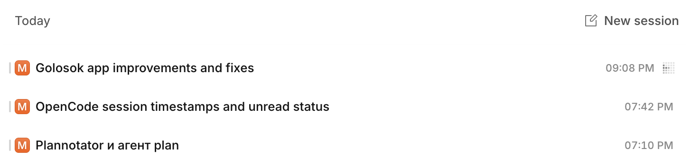
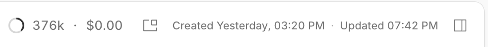
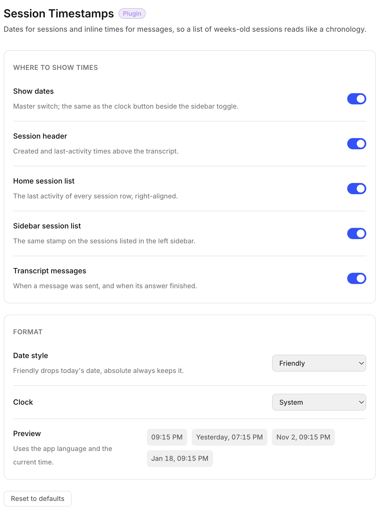
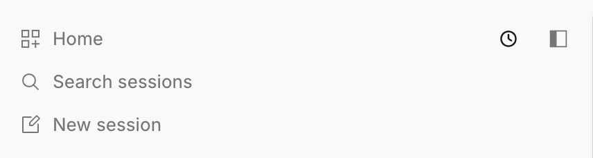
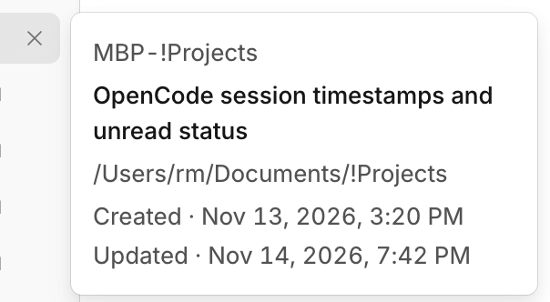

# opencode-session-timestamps

> **Даты и время там, где OpenCode Desktop их не показывает: шапка сессии, списки на Home и в сайдбаре, вкладки и каждый ход в транскрипте.**  
> 🌐 *[English documentation](./README.md)*

[](https://opencode.ai/)
[](https://www.typescriptlang.org/)
[](https://www.solidjs.com/)
[](LICENSE)

---

## Зачем

OpenCode Desktop делит сессии на **Today / Yesterday / Older** и вообще не рисует дату в строке. В транскрипте видна длительность хода, но не момент времени. Поэтому сессия недельной давности и сессия полугодовой давности выглядят одинаково, пока их не откроешь.

Плагин добавляет эти привязки, ничего не меняя на сервере: он читает `session.time.created/updated` и `message.time.created/completed` из уже синхронизированных данных приложения.

---

## ✨ Возможности

- **Шапка сессии** — `Создана 12 нояб., 03:20 · Обновлена 13 нояб., 15:42` рядом с заголовком; полная дата со секундами — в подсказке; в компактном режиме остаётся только последняя активность.
- **Список сессий на Home** — время последней активности справа в каждой строке.
- **Список сессий в сайдбаре** — та же метка. В строках сайдбара нет id сессии в DOM, поэтому они сопоставляются по уникальному заголовку; дубли пропускаются.
- **Вкладки сессий** — компактные часы, резервирующие 24px под статус приложения: точка непрочитанного/вопроса и крестик закрытия их не перекрывают. Скрываются при наведении и в вкладках уже 150px.
- **Подсказка вкладки** — отдельные строки **Создана** и **Обновлена** с полными локализованными датами.
- **Ходы в транскрипте** — `15:42 → 15:43` над сообщением пользователя: когда отправлено и когда закончился ответ. Пока ответ идёт — только время отправки.
- **Быстрый выключатель** — кнопка-часы рядом с тумблером сайдбара скрывает или показывает все даты без захода в настройки (приглушена, когда выключено).
- **Настройки → Время сессий** — общий выключатель, тумблер на каждое место, «дружелюбный» формат (`15:42`, `Вчера, 09:05`, `12 нояб., 15:42`) или всегда полная дата, 12/24-часовые часы и живой пример на текущем языке.
- **Локализация** — словари en/ru, язык приложения подхватывается на лету, фолбэк на английский.

Всё следует языку приложения и обновляется на лету при изменении сессии.

---

## 📸 Скриншоты

### Список сессий на Home



Строка заканчивается временем последней активности, поэтому сессия сегодняшняя, вчерашняя и месячной давности больше не выглядят одинаково.

### Шапка сессии



**Создана** и **Обновлена** стоят рядом с расходом токенов и стоимости; полная дата со секундами — в подсказке.

### Настройки



**Настройки → Время сессий**: общий выключатель, тумблер на каждую поверхность, «дружелюбные» или всегда полные даты, 12/24-часовые часы и живой пример на языке приложения.

### Быстрый выключатель



Кнопка-часы рядом с тумблером панели скрывает или показывает все даты одним кликом (приглушена, когда выключено).

### Подсказка вкладки



В подсказке вкладки появляются отдельные строки **Создана** и **Обновлена** с полными локализованными датами.

---

## 📦 Установка

### Вариант A: из GitHub

```bash
opencode plugin add github:Realmagnum/opencode-session-timestamps
```

### Вариант B: через конфиг

```json
{
  "plugins": ["/абсолютный/путь/к/opencode-session-timestamps"]
}
```

Затем перезагрузите окно через `Cmd+R` — GUI-часть загружается на каждое окно. Нужен OpenCode Desktop 2.2+.

---

## ⚙️ Как устроено

Шапка использует официальный слот `session.header`. У строк Home/сайдбара, вкладок, подсказки и ходов транскрипта слотов нет, поэтому плагин добавляет `<time>` в DOM приложения и согласует их через `MutationObserver`; каждый проход возвращает то, что приложение перерисовало.

- Время загруженных сессий берётся из `ctx.servers[*].data.session` / `data.session.message` (реактивные сторы).
- Для строк, которых нет в сторе, — ограниченный индекс `session.list` (500 последних на сервер), обновляемый на события выполнения, переименования, архивации и удаления.
- Строки сайдбара сопоставляются по уникальному заголовку; вкладки и их подсказка — по `ses_...` из `href`.
- Часы хода связывают id сообщения пользователя с последним `time.completed` ассистента в этом ходе.

---

## 🛠 Сборка

```bash
npm install
npm run build        # vite build + копия gui-experimental.cjs в корень пакета
npm run typecheck
npm test             # паритет ключей i18n и фолбэк
npm run ci           # typecheck + test + build
```

---

## Известные ограничения

- Строки сайдбара с одинаковыми заголовками не подписываются. Home, шапка, вкладки и транскрипт это не затрагивает.
- У хода, чьё сообщение пользователя вне виртуализированного окна, метки не будет, пока оно не появится.
- Метки ходов получает только активный транскрипт; скрытый закэшированный таймлайн сохраняет те, что уже были.
- Часы вкладки скрываются при наведении: там же приложение показывает кнопку закрытия.

---

## Лицензия

MIT
